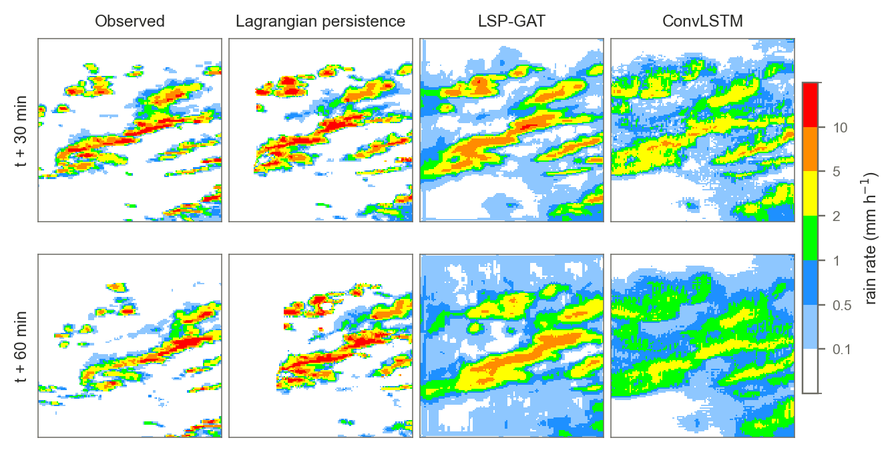

# Superpixel graph attention on a Lagrangian base for radar precipitation nowcasting

This repository contains the code of LSP-GAT (Lagrangian Superpixel Graph Attention Network) and of the forecasts it is compared with: a no-graph control, a ConvLSTM, Lagrangian persistence and Eulerian persistence. The data are the MeteoNet rain radar maps for north-western France.

LSP-GAT forecasts the six radar maps of the next hour, at 10 min steps, as Lagrangian persistence plus a learned correction. A recurrent graph attention network produces the correction, and its nodes are superpixels segmented from the last observed map.



Forecasts for one validation sequence (3 January 2018) at lead times of 30 and 60 min. The two learned models are the runs with seed 42. Colours change at the evaluation thresholds. This is a single case, shown for illustration.

## Files

| File | Role |
|---|---|
| `meteonet_preprocess.py` | Turns the MeteoNet radar files into 128 x 128 sequences of 25 maps |
| `analysis/lagrange_kalicilik.py` | Optical flow and backward advection with one displacement vector per pixel (Lagrangian persistence) |
| `analysis/akis_onhesap.py` | Precomputes the motion field of every sequence |
| `analysis/akis_manifest.py` | Records that tie a motion-field file to its data file |
| `analysis/veri_secimi.py` | Selects the sequences of the training, validation and test sets |
| `analysis/split/strict_split_selection.json` | The selected sequences (8,392 / 2,080 / 2,114) |
| `meteonet_sp_gat_lagrange.py` | LSP-GAT |
| `meteonet_sp_bagimsiz_lagrange.py` | No-graph control |
| `meteonet_iz_gat_lagrange.py` | Regular-block variant: the same network with 4 x 4 pixel blocks as nodes |
| `meteonet_baseline_convlstm.py` | ConvLSTM |
| `analysis/ortak_degerlendirme.py` | Scores the ConvLSTM and the two persistence forecasts |
| `analysis/ortak_degerlendirme_sp.py` | Scores LSP-GAT and the no-graph control on the validation set |
| `analysis/ortak_degerlendirme_sp_test.py` | Scores LSP-GAT and the no-graph control on the test set |

Identifiers and console messages are in Turkish. The model and scoring files also contain switches and entries for variants that are not part of the paper. They are off by default: leave `MOTION_EDGES`, `MOTION_SIGN` and `HORIZON_GAT` unset.

## Requirements

The packages are listed in `requirements.txt`: PyTorch, PyTorch Geometric, NumPy, SciPy, pandas, scikit-image, Matplotlib and imageio. The training runs of the paper used Python 3.13, PyTorch 2.11, PyTorch Geometric 2.6.1, NumPy 2.1, SciPy 1.16 and scikit-image 0.25 on Linux with NVIDIA T4 GPUs.

Run the commands below from the repository root in a Bash shell (Linux, WSL or Git Bash).

## Data

MeteoNet is released by Météo-France: <https://meteofrance.github.io/meteonet/>. Download the rain radar archives of the north-western zone for 2016 to 2018 and unpack them. Each yearly archive contains monthly archives, which must be unpacked as well.

## Usage

The commands below configure the runs through environment variables and use the settings of the paper.

### 1. Sequences

```bash
DOWNSAMPLE=blockmax INPUT_ROOT=<folder with the unpacked .npz files> OUTPUT_DIR=./data python meteonet_preprocess.py
```

This writes `meteonet_nw_train.npy`, `meteonet_nw_val.npy` and `meteonet_nw_test.npy` to `./data`, with 8,393, 2,081 and 2,114 sequences. The selection file then leaves out the last training sequence and the last validation sequence, which cross a split boundary.

### 2. Data check and motion fields

```bash
DATA_DIR=./data python analysis/veri_secimi.py
FLOW=tvl1 DATA_DIR=./data python analysis/akis_onhesap.py train val test
AKIS_HASH_DOGRULA=1 DATA_DIR=./data python analysis/akis_manifest.py --dogrula tvl1
```

The first command checks the three data files. The second command estimates one TV-L1 motion field per sequence. The third command checks the motion-field files. Run all three before training and scoring.

### 3. Training

```bash
STRICT_SPLIT=1 EVAL_TEST=0 BMSE_WEIGHTS=1,1,1,1,1,1,1 TAG_SUFFIX=_mse SEED=42 DATA_DIR=./data OUT_DIR=./outputs python meteonet_sp_gat_lagrange.py
```

Use the same command with `meteonet_sp_bagimsiz_lagrange.py` for the no-graph control, with `meteonet_iz_gat_lagrange.py` for the regular-block variant and with `meteonet_baseline_convlstm.py` for the ConvLSTM. The paper uses the seeds 42, 123 and 456. `BMSE_WEIGHTS=1,1,1,1,1,1,1` selects the plain mean squared error. Each run writes a checkpoint (`.pt`) and a record (`_metrics.json`) to `OUT_DIR`; the scoring scripts read both.

The two superpixel models have built-in checks that run on small synthetic tensors and need no data:

```bash
SELF_TEST=1 python meteonet_sp_gat_lagrange.py
```

### 4. Scores

```bash
MODEL=SP_GAT SPLIT=val DATA_DIR=./data CKPT=./outputs/sp_gat_lagrange_res_mse_seed42.pt python analysis/ortak_degerlendirme_sp.py
MODEL=SP_BAG SPLIT=val DATA_DIR=./data CKPT=./outputs/sp_bag_lagrange_res_mse_seed42.pt python analysis/ortak_degerlendirme_sp.py
MODEL=C0 SPLIT=val DATA_DIR=./data CKPT=./outputs/baseline_convlstm_mse_seed42.pt python analysis/ortak_degerlendirme.py
MODEL=L SPLIT=val DATA_DIR=./data python analysis/ortak_degerlendirme.py
MODEL=E SPLIT=val DATA_DIR=./data python analysis/ortak_degerlendirme.py
```

`SP_GAT` is LSP-GAT, `SP_BAG` is the no-graph control, `C0` is the ConvLSTM, `L` is Lagrangian persistence and `E` is Eulerian persistence. For the test set, use `SPLIT=test`, and `analysis/ortak_degerlendirme_sp_test.py` for the two superpixel models:

```bash
MODEL=SP_GAT SPLIT=test DATA_DIR=./data CKPT=./outputs/sp_gat_lagrange_res_mse_seed42.pt python analysis/ortak_degerlendirme_sp_test.py
```

Scoring the superpixel models on the test set also needs the validation data and motion fields.

The regular-block variant is scored on the validation set only, as in the paper:

```bash
MODEL=IZ_GAT SPLIT=val DATA_DIR=./data CKPT=./outputs/iz_gat_lagrange_res_mse_seed42.pt python analysis/ortak_degerlendirme_sp.py
```

Each call writes a JSON file with the scores and an `.npz` file with the counts of every sequence to `analysis/`, or to the path given in `OUT`.

| Key in the JSON file | Score |
|---|---|
| `S_long_t30_60` | CSI averaged over the six thresholds and the lead times from 30 to 60 min |
| `csi_t10` | CSI at the first lead time, averaged over the six thresholds |
| `csi_at10mmh` | CSI at 10 mm/h with the counts summed over all lead times |
| `pool16_genel` | CSI after 16 x 16 max pooling |
| `kutle_orani` | Mass ratio: forecast rain total divided by observed rain total |

## Settings

Settings of LSP-GAT and of the training of the three learned models, as used in the paper. The no-graph control uses the same superpixels, encoder and decoder.

| Item | Setting |
|---|---|
| Superpixels | SLIC (scikit-image) on the single-channel map with 1,024 requested superpixels, a compactness of 0.1 and connectivity enforced |
| Encoder | Four 3 x 3 convolutions with 32, 32, 64 and 64 channels, each followed by group normalisation (8 groups) and a leaky ReLU; all 3 x 3 convolutions of the encoder and the decoder use a padding of one pixel |
| Recurrent network | Two layers with a state of 64 channels; graph attention with four heads of 64 channels, one head for each gate; forget-gate bias initialised to one |
| Lead-time layer | Learned embedding of 64 channels followed by a linear layer (64 to 64); graph attention with four heads of 16 channels, concatenated, with a residual connection, layer normalisation and a leaky ReLU |
| Decoder | Four 3 x 3 convolutions with 32, 32, 16 and 1 channels; group normalisation (8, 8 and 4 groups) and a leaky ReLU after each of the first three; last layer initialised to zero |
| Leaky ReLU | Negative slope of 0.2 in the encoder, the decoder, the attention and the lead-time layer |
| Optimiser | Adam with a learning rate of 0.001 |
| Learning-rate schedule | Linear warm-up over the first five epochs, then a reduce-on-plateau scheduler that halves the learning rate with a patience of five epochs (minimum 0.000001) |
| Batches | Batch size of 4, gradient clipping at norm 1, mixed precision |
| Stopping | After 15 epochs without improvement of the validation loss, or after 100 epochs |

## Notes

- The defaults of the scripts are not the settings of the paper. For example, preprocessing defaults to bilinear reduction and the ConvLSTM defaults to a weighted loss. Use the commands above. The two superpixel models stop if the settings of the paper are not given.
- The ConvLSTM is autoregressive. After the seven input maps have been processed, the last observed map is the first forecasting input, and each later input is the preceding forecast clipped to [0, 1]. This is the default (`ROLLOUT=dup`) and the setting of the paper; leave `ROLLOUT` unset.
- A new run with the same seed, `TAG_SUFFIX` and `OUT_DIR` overwrites the existing checkpoint. This includes a run with `SMOKE_TEST=1`, so use a separate `OUT_DIR` for trials.
- If the validation loss of a ConvLSTM run is never finite, no checkpoint is written and an older checkpoint in the same `OUT_DIR` is loaded instead. Check the training log before using a checkpoint.
- Always pass `CKPT` when a learned model is scored. Without it, the untrained network is scored.
- `analysis/akis_manifest.py --dogrula` skips motion-field files that are missing. Check that it reports the training, validation and test sets.
- Use the scores written by the scoring scripts for comparisons. The `_metrics.json` file written during training aggregates the CSI differently.
- Trained weights are not included.

## License

MIT. See `LICENSE`. The MeteoNet data have their own licence.
